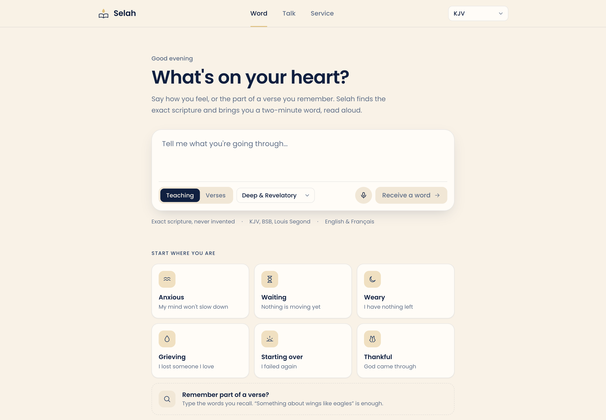
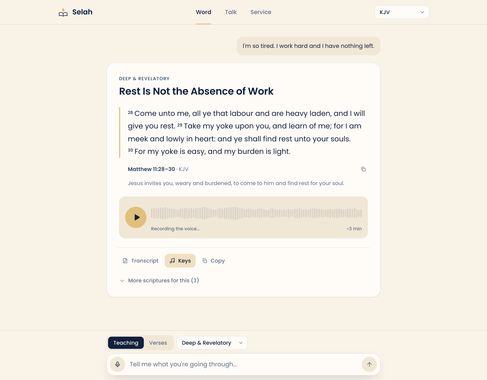
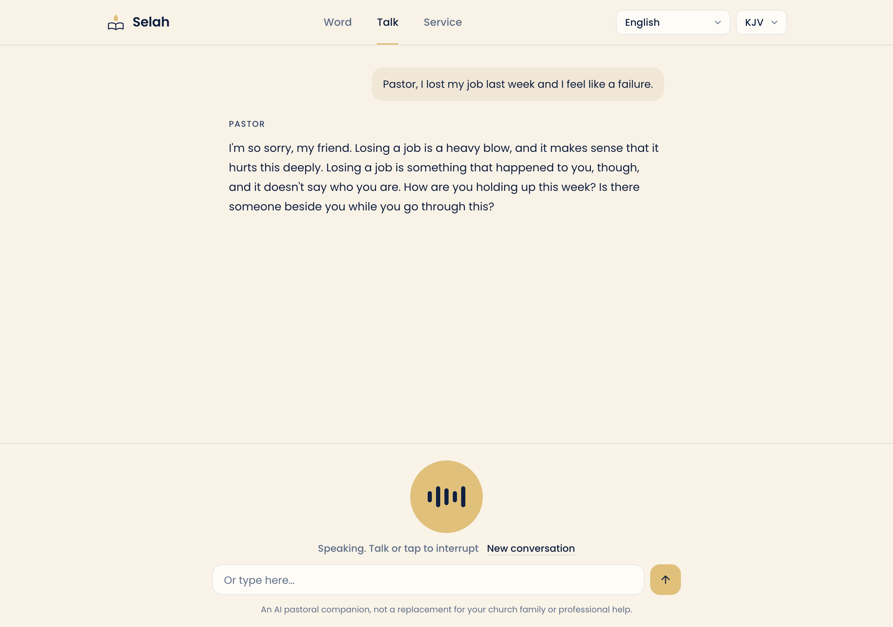
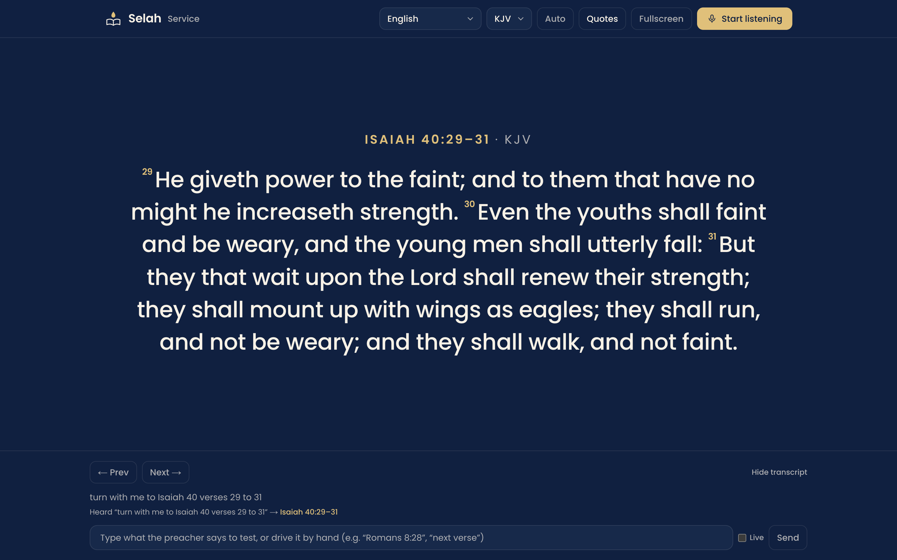
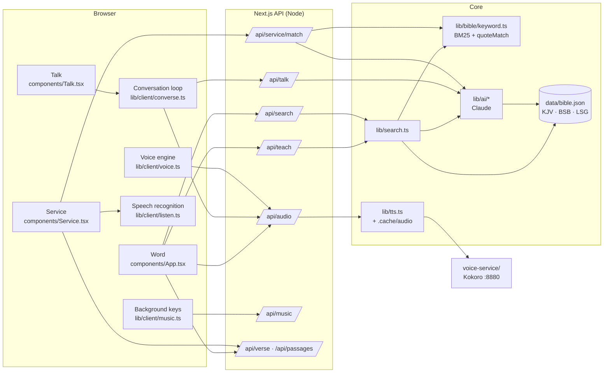

<div align="center">

# Selah

**Tell it how you feel. Find the exact scripture. Hear a two-minute word. Talk with a pastor.
Or put every verse on screen while the sermon is preached.**

An open-source, voice-first Bible companion, built Africa-first and bilingual (English · Français).

[Quick start](#quick-start) · [Features](#what-selah-does) · [How it works](#architecture-deep-dive) · [API](#http-api) · [Contributing](CONTRIBUTING.md) · [Design system](docs/DESIGN.md)



</div>

---

## Why Selah exists

Most Bible apps answer "I'm struggling" with a verse and a caption. Selah tries to do what a good pastor does:
listen to what you actually said, find the scripture that speaks to it (by meaning, or from the half a verse
you remember), and **teach** it: context, insight, application, and a declaration to carry into the day.
Then **say it out loud**, because many people would rather listen, lying in bed at 1 a.m., than read.

It also serves the church itself: **Service mode** listens to a live sermon and puts every verse the preacher
reads, quotes, or even paraphrases on the projector, without anyone typing.

Three promises shape every line of code:

| Promise | What it means in practice |
|---|---|
| **Scripture is never invented** | Verse text always comes from the database. AI models may only *suggest references*, which are verified; teachings quote only passages they were given. |
| **Crisis comes before content** | Two independent checks (patterns + a model) catch danger; the app stops teaching and points to people and emergency numbers. |
| **No one is impersonated** | Teaching styles describe traditions, never real preachers. No voice cloning of real people. |

---

## What Selah does

<table>
<tr>
<td width="50%" valign="top">

### Word: teachings and verses

Type or speak how you feel.

- **Teaching:** an anchor verse plus a ~2-minute spoken teaching in one of four styles (Deep & Revelatory, Restoration, Purpose & Kingdom, Gentle & Hopeful), delivered as **audio with a waveform player**; the text is one tap away ("Transcript").
- **Verses:** the best passages for what you said, each with a one-line reason.
- Finds verses from **fragments** ("something about wings like eagles") and **references in any form** ("Ps 23", "1 cor 13 4-7", "Jean 3:16").
- **Soft background keys** under the voice (generated in the browser, or Epidemic Sound tracks).

</td>
<td width="50%" valign="top">



</td>
</tr>
<tr>
<td valign="top">



</td>
<td valign="top">

### Talk: a conversation with a pastor

A hands-free voice conversation. Speak; the pastor answers out loud, sentence by sentence as the reply is written.

- **Interrupt naturally:** the pastor's voice dips the moment you speak and stops once your words are recognised. It knows it was cut off and won't repeat itself.
- Turn-taking from your **microphone's volume**, so it knows when you've stopped.
- Scripture the pastor mentions is **looked up and shown on screen**, then quoted exactly.
- Short, warm, specific replies that ask one question at a time.

</td>
</tr>
<tr>
<td valign="top">

### Service: a live verse display

Leave it listening during a sermon, connected to a projector.

- **Spoken references:** "turn with me to Romans chapter eight verse twenty-eight", "next verse", "verse 29", "go back to verse one", "Jean chapitre trois verset seize".
- **Real transcription quirks:** "Romans 828" → 8:28, "Sam's 91" → Psalm 91.
- **Quotes and paraphrases without a reference:** "the Bible says we should honour our father and mother" → Exodus 20:12, often **before the sentence ends**.
- Hold mode (a volunteer approves each verse), keyboard stepping, fullscreen, and a visible "Heard … →" line for every phrase.

</td>
<td valign="top">



</td>
</tr>
</table>

**Also:** day and night themes that follow your phone, a phone-first layout with a bottom tab bar
(<a href="docs/screenshots/home-mobile-dark.png">see it</a>), French end to end (Louis Segond 1910, French
references, French crisis resources), and switching Bibles re-reads every passage already on screen.

---

## Quick start

**Requirements:** Node.js 20+ and an [Anthropic API key](https://console.anthropic.com). For the free voice: [uv](https://docs.astral.sh/uv/) (it fetches Python 3.12 for you).

```bash
git clone https://github.com/Deshnicdeveloper/random-idea.git selah && cd selah
npm install
npm run setup                     # downloads the public-domain Bibles (~21 MB) and builds data/bible.json
cp .env.local.example .env.local  # then paste ANTHROPIC_API_KEY into .env.local
npm run dev                       # http://localhost:3000
```

Without an API key, Scripture search still works (references, keyword search, hand-picked passages).
Teachings, Talk and Service's paraphrase check need the key.

### Add the free, natural voice (Kokoro)

```bash
npm run voice:setup   # Python 3.12 env + Kokoro model files (~355 MB, from GitHub)
npm run voice         # keep this running next to `npm run dev`
```

Then set `TTS_PROVIDER=kokoro` in `.env.local`. Without any voice provider, read-aloud uses the browser's
built-in voice and teachings show as text.

> **Use Chrome, Edge or Safari** for anything that listens (mic input, Talk, Service). Live speech
> recognition uses the browser's engine and needs an internet connection. Wear headphones in Talk mode.

### Commands

| Command | What it does |
|---|---|
| `npm run setup` | Download Bible sources into `data/raw/` and build `data/bible.json` |
| `npm run dev` / `build` / `start` | Next.js dev server / production build / production server |
| `npm run voice:setup` / `voice` | Install / run the local Kokoro voice service on `:8880` |
| `npm run typecheck` | TypeScript check |
| `npm test` | Unit tests (`tests/`); data-dependent tests skip until `setup` has run |

---

## Configuration

All settings live in `.env.local` (see [`.env.local.example`](.env.local.example)).

| Variable | Default | Purpose |
|---|---|---|
| `ANTHROPIC_API_KEY` | — | Required for teachings, Talk, AI verse suggestions and paraphrase recognition |
| `TEACHING_MODEL` | `claude-opus-5-5` | Writes teachings (depth matters most) |
| `TEACHING_EFFORT` | `low` | Thinking effort for teachings; `low` keeps first words to ~3 s |
| `CONVERSATION_MODEL` | `claude-sonnet-5-5` | Talk mode (fastest first words); pre-answer thinking is off |
| `HELPER_MODEL` | `claude-haiku-5-5` | Verse suggestions, crisis check, Service paraphrase check |
| `TTS_PROVIDER` | auto | `kokoro`, `elevenlabs`, `azure` or `browser`. Auto = ElevenLabs/Azure if their key is set, else browser |
| `KOKORO_URL` | `http://127.0.0.1:8880` | Where the voice service runs |
| `KOKORO_VOICE_EN` / `_FR` | `am_michael` / `ff_siwis` | Any Kokoro voice, or a blend: `am_onyx:0.6+am_michael:0.4` |
| `KOKORO_SPEED` | `0.92` | Speaking rate |
| `ELEVENLABS_API_KEY`, `ELEVENLABS_VOICE_ID(_FR)`, `ELEVENLABS_MODEL` | — / George / `eleven_multilingual_v2` | ElevenLabs voice |
| `AZURE_SPEECH_KEY`, `AZURE_SPEECH_REGION`, `AZURE_VOICE_EN/FR` | — / — / `en-NG-AbeoNeural`, `fr-FR-HenriNeural` | Azure neural voice (Nigerian English available) |
| `EPIDEMIC_API_KEY` | — | Background music from Epidemic Sound (free keys are for prototyping only) |

---

## Architecture deep dive



```
app/                 pages (/, /talk, /service) and API routes (app/api/*)
components/          UI: App (Word), Talk, Service, Player, Cards, Shell, Icons
lib/bible/           data access, reference parsing, keyword search, topic map, generated book list
lib/ai/              Claude: analyze (suggest refs + crisis), teach, talk, identify (paraphrases)
lib/service/         spoken-reference detector for live sermons
lib/client/          browser engines: voice, conversation, listening, music, mic input
lib/                 search pipeline, safety, language, TTS, shared types
voice-service/       Kokoro text-to-speech server (Python)
scripts/             Bible download + build
tests/               unit tests (node:test)
docs/                design system, screenshots
```

### 1. The Bible data layer

- **Sources** (`scripts/download-bible.sh`): KJV and the Berean Standard Bible (BSB) from
  [scrollmapper/bible_databases](https://github.com/scrollmapper/bible_databases), Louis Segond 1910 from
  [Beblia/Holy-Bible-XML-Format](https://github.com/Beblia/Holy-Bible-XML-Format). All public domain.
- **Build** (`scripts/build-bible.mjs`): aligns all three to the same versification (31,102 verse slots;
  the BSB omits 16 verses absent from its source manuscripts, which fall back to the KJV with a visible note),
  writes `data/bible.json` (`[translation][book][chapter][verse]`) and a tiny `lib/bible/books.generated.ts`
  (English + French names, verse counts) that the browser can use without the text.
- **Passages** (`lib/bible/data.ts`): every verse shown anywhere goes through `passageFrom()`. It caps ranges,
  names books in the passage's language ("Psaume 23"), and is the single place verse text comes from.

### 2. Finding scripture (`lib/search.ts`)

A message goes through these layers, stopping as soon as one is conclusive:

1. **Typed reference** (`lib/bible/reference.ts`): English and French names, abbreviations, roman numerals,
   accents, "Jude 24" style single-chapter books, French references choose Louis Segond automatically.
2. **AI suggestions** (`lib/ai/analyze.ts`, Haiku, structured output): one fast call returns a crisis level,
   intent, up to 8 *references* with a one-line reason, and search keywords. Each reference is parsed and
   looked up; anything that doesn't exist is silently dropped. **The model never supplies verse text.**
3. **Hand-picked passages** (`lib/bible/topics.ts`): when there's no AI, common feelings (anxiety, grief,
   waiting, failure… in English and French) map to strong, curated passages, ordered by where each feeling
   appears in the message.
4. **Keyword search** (`lib/bible/keyword.ts`): BM25 over KJV + BSB + LSG indexed together, light stemming,
   archaic-word folding (thee → you), a coverage boost, and a **word-pair re-rank** so half-remembered
   quotes land on the right verse ("be still and know" → Psalm 46:10, not a verse that merely shares words).

### 3. Teachings (`lib/ai/teach.ts`, `app/api/teach`)

- The anchor is the top passage from search (shown immediately); the teacher writes ~250–310 spoken words.
- Each **style guide** describes *how that kind of preacher builds a message*: e.g. Deep & Revelatory
  opens with a distinction most people miss, builds on numbered principles, uses a biblical character as a
  case study, coins a "write this down" line, asks a probing question, and closes with "Father…" prayer
  points. An original example (with its verse pulled from the database) anchors the rhythm.
- Rules in the system prompt: quote only provided passages, cite others by reference (they become
  tappable links in the transcript), never imitate a named preacher, no promises God hasn't made, no
  medical/legal/financial directives, reply in the person's language, close with `DECLARATION:`.
- Streams as newline-delimited JSON: `passages` → `title` → `delta`… → `done` (or `crisis` / `error`).
- Model: Claude Opus 5.5 at low effort (first words ≈ 3 s, ≈ 3 cents per teaching) with server-side
  refusal fallback.

### 4. Voice (`lib/tts.ts`, `lib/client/voice.ts`, `voice-service/`)

- **Providers:** Kokoro (free, local, Apache-2.0), ElevenLabs, Azure, or the browser's own voice.
- **Record once, keep forever:** each piece of text becomes one MP3, saved in `.cache/audio/` under a hash of
  provider + voice + text (+ neighbouring text where it affects delivery). Replays, seeks and refreshes never
  regenerate (or cost) anything. Concurrent requests for the same text share one generation.
- **Progressive playback:** the teaching is split into a short first piece (~260 chars) then ~700-char
  pieces (`lib/speech-pieces.ts`). Pieces are recorded in order; the Web Audio player starts on piece one
  and schedules the rest back to back, showing a waveform that fills in as audio arrives (recorded / still
  recording / played). Seeking is limited to what's recorded.
- **Free voice = record ahead:** with Kokoro, audio starts recording the moment the teaching is written,
  so Play is usually instant.
- **The Kokoro service** (`voice-service/server.py`) runs every synthesis on **one long-lived worker
  thread**. The underlying speech engine pays ~3 s of setup on each new thread; a thread-per-request server
  made a short phrase take ~3.4 s instead of ~0.6 s. It also supports voice blends and adds natural pauses
  between paragraphs. The full ONNX model is used: on Intel CPUs it was ~3× faster than the int8 model.

### 5. Background keys (`lib/client/music.ts`, `lib/music.ts`)

A soft keyboard bed under the teaching voice: by default **generated in the browser** (electric-piano tones
over a pad, a slow D♭ worship progression, convolution reverb), so it costs no data and needs no licence. With
`EPIDEMIC_API_KEY`, a calm instrumental Epidemic Sound track is used instead (one link reused for up to an
hour; iPhones use the built-in keys because they ignore `<audio>` volume).

### 6. Talk mode (`lib/client/converse.ts`, `lib/ai/talk.ts`)

- **Turn-taking:** a voice-activity detector reads the mic's volume (with echo cancellation). Your turn ends
  on whichever comes first: ~0.65 s of quiet, the recogniser finalising your words, or your words not
  changing for 1.4 s. Tap the orb to send immediately.
- **Barge-in:** when your voice starts while the pastor speaks, the pastor's volume dips at once; when your
  words are recognised **and aren't the pastor's own words echoing back**, playback stops, the request is
  cancelled, and the reply is saved as far as it was spoken (ending "—"), so the model knows it was cut off.
  If you paused mid-thought before the pastor said anything, your next words join the same message.
- **Speaking as it writes:** the streamed reply is split into sentences; the first sentence goes to the
  voice immediately, later ones are grouped for smoother delivery, recorded strictly in order.
- **The pastor** (Claude Sonnet 5.5, pre-answer thinking off): short spoken replies, one question at a time,
  a `show_scripture` tool that puts the exact passage on screen before quoting it, and a `show_crisis_help`
  tool. It says it's an AI when asked.

### 7. Service mode (`lib/service/spoken.ts`, `quoteMatch`, `lib/ai/identify.ts`)

- **Spoken references** are parsed from live transcripts: number words in English and French ("one hundred
  and nineteen", "quatre-vingt-onze"), ordinals ("first Corinthians", "1st"), "chapter … verse …", ranges,
  fused numbers ("Romans 828" → 8:28, with sensible tie-breaking), common mishearings ("Sam's" → Psalms), and
  relative commands ("next verse", "read on", "verse 29", "verset suivant") against the passage on screen.
  It is deliberately strict: a book name must be followed by numbers, and names that are also everyday words
  or first names (John, Mark, Job, Kings…) need a verse number or a lead-in ("turn to").
- **Quotes without a reference**, in two layers:
  1. *Exact words* (`quoteMatch`): a verse matches when a large share of its own word pairs were spoken, or a
     run of 7+ of its words with real content, in KJV, BSB or LSG wording. Formulaic lines that fit many verses
     equally ("the word of the Lord came unto me") are rejected.
  2. *Paraphrase check* (Haiku, no pre-answer thinking): "he shall prepare a table for me in front of kings"
     → Psalm 23:5. Sayings that appear in several places get their best-known occurrence; general themes get
     nothing. The reference is verified against the database.
- **Checks run while the preacher is still talking:** exact-word checks every few words, the paraphrase check
  on finished phrases, after cue phrases ("the Bible says", "it is written", "Jesus said", "la Bible dit"), or
  after a long stretch of speech. Up to two checks run at once, a late answer can never overwrite a newer verse,
  and the remainder of a phrase that already produced a verse is not searched again.

### 8. Safety (`lib/safety.ts`)

- A pattern check (English and French) runs on every message with no network needed; the AI analysis and the
  Talk pastor add their own judgement. Either can raise the alarm.
- **Urgent:** no teaching. A card with emergency numbers (currently Cameroon's 119 SAMU and 117 police, and
  "call your local emergency number" elsewhere), a link to [findahelpline.com](https://findahelpline.com),
  encouragement to call someone trusted, and Psalm 34:18 from the database.
- **Concern** (deep, lasting hopelessness): the teaching continues with a gentle note pointing to people.
- Numbers must be verified for every country you launch in.

### 9. Languages (`lib/lang.ts`)

The message's language is detected (English / French); French answers use Louis Segond, French book names,
French crisis copy, and French teaching prompts (using *tu*). Talk mode replies in the language you speak.

---

## HTTP API

All routes are under `app/api/` and run on Node.

| Route | Request | Response |
|---|---|---|
| `POST /api/search` | `{ message, translation }` | `SearchResponse`: `{ lang, translation, crisis, resources?, passages[], source, notice? }` |
| `POST /api/teach` | `{ message, style, translation }` | NDJSON stream of `TeachEvent`: `passages`, `title`, `delta`, `crisis`, `error`, `done` |
| `GET /api/verse?ref=John%203:16&t=KJV` | — | a `Passage`, or 404 |
| `POST /api/passages` | `{ translation, items: [{book, chapter, start, end, reason?}] }` | `{ passages: (Passage \| null)[] }` (used to switch Bibles) |
| `GET /api/audio` | — | `{ provider, free }` |
| `POST /api/audio` | `{ text, lang, previous?, next? }` | `audio/mpeg`, header `X-Audio-Cache: hit \| miss` |
| `GET /api/music` | — | an Epidemic track `{ url, title, artist }` or `{ source: "builtin" }` |
| `POST /api/talk` | `{ history: [{role, content}], translation }` | NDJSON: `delta`, `passage`, `crisis`, `error`, `done` |
| `POST /api/service/match` | `{ speech, translation, ai?, exclude? }` | `{ match: { passage, via: "words" \| "ai" } \| null }` |

Types live in [`lib/types.ts`](lib/types.ts). Voice service: `GET :8880/health`, `POST :8880/tts { text, voice, lang, speed, pause_after }` → MP3.

---

## Measured performance

On a 2019 Intel MacBook Pro running everything locally (your numbers will be better on a modern machine or server):

| Step | Result |
|---|---|
| Teaching: first words of text | ~3 s (Opus 5.5, low effort) |
| Teaching: first audio piece (Kokoro, recorded ahead) | a few seconds after the text; then faster than it plays |
| Kokoro short phrase | 0.55–0.7 s ("I hear you, my friend.") |
| Talk: end of your speech → pastor's voice | ~3–6 s (Sonnet first words 1.0–1.4 s) |
| Service: spoken reference → on screen | as soon as it's transcribed (local parsing) |
| Service: quote → on screen | often mid-sentence (e.g. 3.6 s into a 7.6 s sentence); paraphrase check 1.4–2.5 s |
| Quote match (exact words) | ~20 ms |

---

## Known limitations

- **Live listening depends on the browser's speech recognition**: Chrome/Edge/Safari only, online only, one
  language at a time, and noisy halls reduce accuracy. A self-hosted recogniser (e.g. Whisper) is a natural
  next step.
- **Talk mode isn't a real-time voice model.** It chains speech → text → reply → voice, so it's a few seconds,
  not instant. Speech-native models could get it near one second.
- **Kokoro has no African-accented or male French voice.** Blends and male voices speaking French help;
  premium providers offer more.
- **Ambiguous fused numbers** ("Hebrews 111" → 1:11 rather than 11:1) prefer the one-digit chapter.
- **The audio cache lives on local disk.** On serverless hosting, move it to object storage.
- **No accounts or history yet.** Conversations live in the page.

## Deploying

- The Next.js app runs anywhere Node runs (Vercel works; `data/bible.json` is bundled with the API routes).
- The **Kokoro voice service** needs a small always-on machine (2 vCPU / 4 GB is enough to start), not
  serverless. Point `KOKORO_URL` at it.
- Set `ANTHROPIC_API_KEY` and your voice settings as environment variables. Verify crisis numbers for your
  country.

## Roadmap

Ideas the community can pick up. Open an issue to claim one.

- **WhatsApp:** voice note in, voice note out, on the same `findPassages()` / `streamTeaching()` core
- **Journal and series:** save what spoke to you; 3–7 day series for grief, waiting, fear
- **More languages and Bibles:** Pidgin, Swahili, Yoruba, Spanish, Portuguese… (see CONTRIBUTING recipes)
- **Self-hosted live transcription** for Service mode (Whisper) and **bilingual services**
- **Real-time voice** for Talk mode
- **Church features:** service setlists, presenter integrations (ProPresenter, OBS), multi-screen output
- **Accounts, privacy controls and offline/PWA support**
- **Evaluation sets** for teachings and Service recognition

## Contributing

Contributions of every kind are welcome: code, testing in real services, translations, theology review,
accessibility, design. Start with [CONTRIBUTING.md](CONTRIBUTING.md) for setup, the project's non-negotiable
principles, and step-by-step recipes (add a translation, a language, a teaching style, a voice provider).
Please follow the [Code of Conduct](CODE_OF_CONDUCT.md).

## Licences and credits

- **Code:** [MIT](LICENSE).
- **Bible texts:** King James Version, Berean Standard Bible and Louis Segond 1910 are public domain, via
  [scrollmapper/bible_databases](https://github.com/scrollmapper/bible_databases) and
  [Beblia/Holy-Bible-XML-Format](https://github.com/Beblia/Holy-Bible-XML-Format).
- **Voice:** [Kokoro-82M](https://huggingface.co/hexgrad/Kokoro-82M) (Apache-2.0) via
  [kokoro-onnx](https://github.com/thewh1teagle/kokoro-onnx) (MIT). Kokoro uses
  [eSpeak NG](https://github.com/espeak-ng/espeak-ng) (GPL-3.0) for pronunciation, installed separately
  by `voice:setup`.
- **AI:** [Claude](https://www.anthropic.com/claude) by Anthropic. Optional: ElevenLabs, Azure Speech, Epidemic Sound
  (each under its own terms; Epidemic's free developer key is for prototyping only).
- **Type:** [Poppins](https://fonts.google.com/specimen/Poppins) (OFL).

## A note of care

Selah is a companion, not a church, a counsellor or a doctor. Teachings are written by AI: weigh them against
the Word, and keep walking with real people. If you or someone you love is in danger, contact local emergency
services or find a helpline at [findahelpline.com](https://findahelpline.com).
